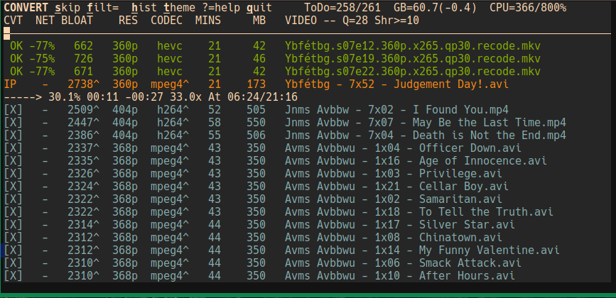

# `rmbloat` - the smart video converter for media server owners

`rmbloat` is an interactive bulk video converter for media servers. It scans a collection, ranks inefficient files by a BLOAT metric, and converts the selected videos to HEVC in low-priority background batches.

> Note: v1 (1.0.0) addressed bugs and security preserving v0.8.5 features.



## Install

```bash
pipx install rmbloat
sudo apt update && sudo apt install ffmpeg
rmbloat --chooser-tests
```

[`pipx`](https://realpython.com/python-pipx/) installs command-line Python applications in isolated environments. `rmbloat` is tested with FFmpeg v7; v6 should also work.

Software encoding works with system FFmpeg, but it is slow. Hardware acceleration (VA-API) is strongly recommended for large collections; see [Advanced Setup](docs/advanced-setup.md) for drivers, Docker/Podman, and verification.

## Quick Start

```bash
rmbloat /path/to/videos
```

After the scan and probe finish, the selection screen opens. Review the preselected files and press `g` to start converting.

## Usage

```bash
rmbloat [options] [files ...]
```

Files and directories are optional when saved defaults exist. Directories are scanned recursively; non-video files are ignored. Failed probes are skipped, and successful probes are cached to speed up later runs.

`rmbloat` ranks files by `bloat = 1000 * bitrate / sqrt(height*width)`. The default threshold is 1600; higher values indicate files that are more likely to shrink substantially. See [Bloat Metric](docs/how-it-works.md#bloat-metric) for the full scale.

Options worth setting deliberately:

| Option | Purpose | Default |
|--------|---------|---------|
| `-b, --bloat-thresh` | Minimum bloat score to select | 1600 |
| `-q, --quality` | Output quality (CRF 0-51; lower is better) | 28 |
| `-H, --max-height` | Downscale videos taller than this many pixels | 65536 |
| `-a, --allowed-codecs` | Codecs eligible for conversion (`x26*`, `x265`, `all`) | x265 |
| `-m, --min-shrink-pct` | Replace only if the result is at least this much smaller | 10 |
| `-B, --keep-backup` | Rename originals to `ORIG.{videofile}` instead of deleting | off |
| `--use-trash` | Send originals to the trash | off |
| `-M, --merge-subtitles` | Merge external `.en.srt` subtitles into the output | off |
| `-p, --prefer-strategy` | Force an FFmpeg strategy instead of `auto` | auto |
| `-t, --thread-cnt` | Software encoder threads (0 = let FFmpeg decide) | 4 |
| `-S, --save-defaults` | Save the current options and paths as defaults | off |
| `-s, --sample` | Write a 30-second sample next to each input | off |
| `--auto-hr` | Run unattended for N hours | off |
| `-T, --chooser-tests` | Test FFmpeg strategies | off |
| `-L, --logs` | View conversion logs (requires `less`) | off |

- Boolean switches such as `-B`, `-M`, and `--use-trash` have explicit `--no-*` forms; when both are given, the last one wins.
- Save your collection paths and preferred options once with `-S`; later runs can omit the paths.
- Limit output resolution with `-H 1080` or `-H 2160`; save it with `-H 1080 -S`.
- Run `rmbloat --help` for the complete list, including display, theme, sandbox, and override options.
- For unattended or scheduled runs, see [Running rmbloat as a Daemon](docs/running-as-daemon.md).

## The Interface

The usual workflow is:
* Start in the **SELECT** screen, where you review and adjust the automatic choices.
* Press `g` to enter the **CONVERT** screen; you can skip single conversions or abort the entire set.
* To investigate a conversion, open **History** and expand the entry's details (which can be done w/o interruption the conversions).

**Selection** lists candidates sorted by bloat, highest first. `[X]` is selected and `[ ]` is not; `^` marks a value over the active threshold. Space toggles the highlighted row and advances, `s` skips it, `r` clears all selections, `i` restores automatic selection, and `g` starts converting. `/` filters by case-insensitive regular expression. The header summarizes the active options.

Rows can also show `---` (manually skipped), `?Pn` or `ErN` (probe or conversion failed), `OPT` (previous result shrank too little), and `DUN` (already a `.recode.mkv` output).

**Conversion** shows only the selected queue with per-file and overall progress. `s` skips the current file, and `q` aborts the current conversion and returns to Selection.

**History** is opened with `h` from Selection or Conversion. Move to an entry and press `e` to cycle collapsed, partial, and full details; `/` searches entries, `a` changes the time format, and `c` copies the selected entry.

**Help** is available with `?`: it lists the vi-like navigation keys, state toggles, actions, and the filter key. Press `?` again to close it.

## Documentation subtopics

* **[Advanced Setup](docs/advanced-setup.md)**: System requirements, VA-API and Docker/Podman setup, strategy selection, sandbox security
* **[How It Works](docs/how-it-works.md)**: Bloat metric, file renaming, quality adjustment, logging, retry ladder, stream handling
* **[Troubleshooting](docs/troubleshooting.md)**: Acceleration, permissions, Docker, failures, stale locks, slow conversions
* **[FAQ](docs/faq.md)**: Instances, quality, timing, pause/resume, originals, platforms, AV1
* **[Running rmbloat as a Daemon](docs/running-as-daemon.md)**: tmux, `rmbloatd`, auto mode, cron, systemd timers
